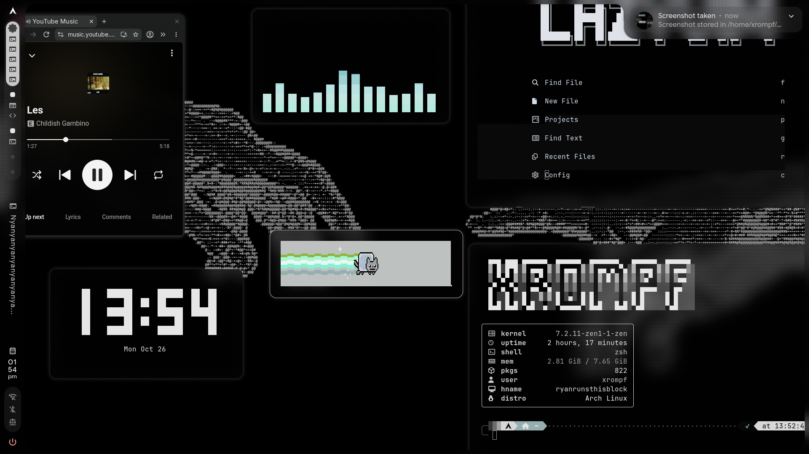

# hyprland-infinite-desktop-v2
ported this very useful and powerful script on caelestia as it didnt work beforehand.


A powerful script to transform your Hyprland workspace into an "infinite" canvas. This tool allows you to pan all floating windows simultaneously using your mouse and navigate between them with keyboard shortcuts, creating a dynamic and boundless desktop experience.




## 🚀 Features

-Infinite Panning: Move the entire "canvas" of floating windows by holding a modifier combination and moving your mouse.

-Smart Navigation: Cycle focus between floating windows

## New features

-Now works in LUA (Hyprland 0.55+).

-Toggle tiling floating/layout.

-Rezize and move windows without mouse.

-Better navigation.


## 📥 Installation

# Automatic:


# Manual:

1. **Requirements**
   You need Python 3, jq, bash, python-evdev installed on your system.

   ### Installation by Distribution:

   * **Arch Linux:**
     ```bash
     sudo pacman -S python python-evdev bash jq
     ```

   *For Fedora or Debian-based distributions, make sure you have the latest version of Hyprland compiled or installed.*

   * **Fedora:**
     ```bash
     sudo dnf install python python-evdev bash jq
     ```
   * **Ubuntu / Debian:**
     ```bash
     sudo apt install python python-evdev bash jq
     ```

2. **Permissions**

   Add your user to the group:
   ```bash
   sudo usermod -aG input $USER
   ```

   Restart your session:
   ```bash
   sudo reboot
   ```

3. **Create the directory:**
   All scripts must be stored in a dedicated folder in your home directory:
   ```bash
   mkdir -p ~/scripts
   ```
4. **Download the scripts:**
   Place all scripts (.py and .sh) inside ~/scripts/

5. **Grant execution permissions:**
   ```bash
   chmod +x ~/scripts/infinite-desktop.sh ~/scripts/floating_tile_toggle.py ~/scripts/move_window_tiled.py ~/scripts/navigate_windows.py ~/scripts/resize_window.py
   ```

## ⚙️ Configuration (for manual installation)

1. **Auto-start** Add the following lines to your ~/.config/caelestia/hypr-user.lua:

2. **Keybindings** Add the following lines to your ~/.config/caelestia/hypr-vars.lua:
   Add these binds to enable keyboard navigation between your floating windows:
   ```bash
 hl.on("hyprland.start", function()
     hl.exec_cmd("python3 ~/scripts/infinite_desktop_core.py 1.6 > /tmp/infinite-desktop.log 2>&1")
end)

    ```
    
   ***(if you already have a bind that uses one of the required keys or for workspaces, replace them)***
   ```bash

local mainMod = "SUPER"

-- Workspaces
hl.bind(mainMod .. " + Z", hl.dsp.focus({ workspace = "-1" }))
hl.bind(mainMod .. " + X", hl.dsp.focus({ workspace = "+1" }))
hl.bind(mainMod .. " + SHIFT + Z", hl.dsp.window.move({ workspace = "-1" }))
hl.bind(mainMod .. " + SHIFT + X", hl.dsp.window.move({ workspace = "+1" }))

-- Infinite desktop 
hl.bind(mainMod .. " + G", hl.dsp.exec_cmd("python3 ~/scripts/floating_tile_toggle.py"))

-- Window Navigation
hl.bind(mainMod .. " + left",  hl.dsp.exec_cmd("python3 ~/scripts/navigate_windows.py left"))
hl.bind(mainMod .. " + right", hl.dsp.exec_cmd("python3 ~/scripts/navigate_windows.py right"))
hl.bind(mainMod .. " + up",    hl.dsp.exec_cmd("python3 ~/scripts/navigate_windows.py up"))
hl.bind(mainMod .. " + down",  hl.dsp.exec_cmd("python3 ~/scripts/navigate_windows.py down"))

-- 1. CLEAR THE INTERFERENCE FIRST
hl.unbind(mainMod .. " + ALT + left")
hl.unbind(mainMod .. " + ALT + right")
hl.unbind(mainMod .. " + ALT + up")
hl.unbind(mainMod .. " + ALT + down")


-- Move Tiled Windows
hl.bind(mainMod .. " + ALT + left",  hl.dsp.exec_cmd("python3 ~/scripts/move_window_tiled.py left"))
hl.bind(mainMod .. " + ALT + right", hl.dsp.exec_cmd("python3 ~/scripts/move_window_tiled.py right"))
hl.bind(mainMod .. " + ALT + up",    hl.dsp.exec_cmd("python3 ~/scripts/move_window_tiled.py up"))
hl.bind(mainMod .. " + ALT + down",  hl.dsp.exec_cmd("python3 ~/scripts/move_window_tiled.py down"))

-- Move Windows (Repeating)
hl.bind(mainMod .. " + SHIFT + left",  hl.dsp.exec_cmd("python3 ~/scripts/move_window.py left"),  { repeating = true })
hl.bind(mainMod .. " + SHIFT + right", hl.dsp.exec_cmd("python3 ~/scripts/move_window.py right"), { repeating = true })
hl.bind(mainMod .. " + SHIFT + up",    hl.dsp.exec_cmd("python3 ~/scripts/move_window.py up"),    { repeating = true })
hl.bind(mainMod .. " + SHIFT + down",  hl.dsp.exec_cmd("python3 ~/scripts/move_window.py down"),  { repeating = true })

-- Resize Windows (Repeating)
hl.bind(mainMod .. " + CTRL + left",  hl.dsp.exec_cmd("python3 ~/scripts/resize_window.py left"),  { repeating = true })
hl.bind(mainMod .. " + CTRL + right", hl.dsp.exec_cmd("python3 ~/scripts/resize_window.py right"), { repeating = true })
hl.bind(mainMod .. " + CTRL + up",    hl.dsp.exec_cmd("python3 ~/scripts/resize_window.py up"),    { repeating = true })
hl.bind(mainMod .. " + CTRL + down",  hl.dsp.exec_cmd("python3 ~/scripts/resize_window.py down"),  { repeating = true })

-- Variable Overrides (Keep this at the very bottom of the file)
return {
    browser = "helium-browser", 
}

   ```
3. copy the code in variables.lua from this repository to ~/.config/hypr/variables.lua
## 🖱️ How to use

 **Workspaces:** Press ***SUPER + Z or X*** to change of workspaces.
 
 **Panning:** Hold ***SUPER + ALT*** and move your mouse to slide the entire desktop.
 
 **Navigation:** Press ***SUPER + Arrow Keys*** to center and focus the next floating/tiled window.
 
 **Toggle floating/layout:** Press ***SUPER + D*** to toggle all windows floating/mosaic.
**Toggle floating/layout:** Press ***SUPER + G*** to toggle all windows floating/mosaic.


 **Rezize window:** Press/hold ***CTRL + SUPER + Arrow Keys*** to rezize windows.

 **Move windows:** Press/hold ***SHIFT + SUPER + Arrow Keys*** to move windows on floating.

 **Move tiled windows:** Press ***SUPER + ALT + Arrow Keys*** yo move tiled windows.
